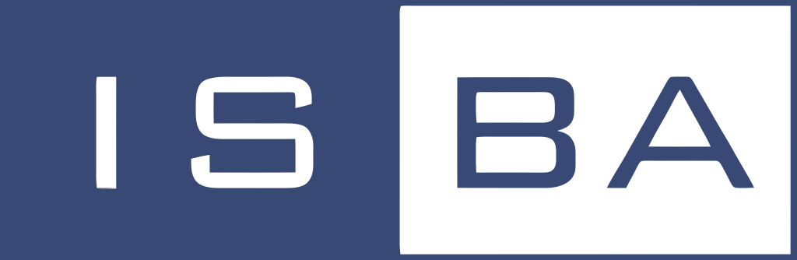
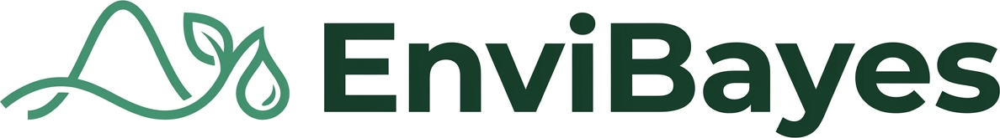

<!-- ::: {.callout-warning appearance="minimal" icon="false"} -->
<!-- **Abstract submission**  -->
<!-- now open - submit [here](https://github.com/EnviBayesINLA/workshop/docs)  -->
<!-- update link with google form -->

<!-- **Deadline**: XXXX -->
<!-- ::: -->

::: {style="text-align: justify;"}
The EnviBayes–INLA Workshop 2027 is the first joint meeting between the EnviBayes and INLA workshop series, bringing together researchers developing Bayesian methods for environmental, ecological, spatial and spatio-temporal statistics. The programme will feature keynote lectures, contributed talks, poster sessions, and hands-on tutorials, covering a broad range of topics including INLA, spatial modelling, extreme value analysis, climate and weather, ecology, epidemiology, and environmental applications. The workshop builds on the success of previous EnviBayes workshops ([2023](https://statistics.colostate.edu/envibayes-workshop/?utm_source=chatgpt.com), [2025](https://sites.google.com/view/envibayes2025tamu/home?utm_source=chatgpt.com)) and the [INLA: Past, Present and Future workshop](https://inla-workshop.github.io/INLA-PastPresentFuture/), creating a unique opportunity for collaboration between these two vibrant research communities.
:::

## Activities Overview {#sec-activities}

::: {.activities-box}

::: {.columns}

::: {.column width="50%"}
- Two pre-conference tutorials
- Keynote talks
- Contributed talks
- Poster session
:::

::: {.column width="50%"}
- Welcome reception
- Social event
- Awards
:::

:::

:::


<!-- ## Interested in attending? -->

<!-- Planning to join us in Glasgow for the EnviBayes–INLA Workshop 2027? -->

<!-- If you are interested in attending, please add your name and email address below. We will let you know when registration and abstract submission open. -->

<!-- Completing this form is **not a registration** and does not commit you to attending. -->

<!-- ```{=html} -->
<!-- <div style="margin: 1.5rem 0 2rem 0;"> -->
<!--   <a href="https://docs.google.com/forms/d/e/1FAIpQLSeBn7uD48kb6tDXxMuqfQZf3yFsVt9K-WgYIQACOr89VwOnwA/viewform" -->
<!--      target="_blank" -->
<!--      class="btn btn-primary" -->
<!--      style="font-size: 1.05rem; padding: 0.65rem 1.3rem;"> -->
<!--     Register your interest -->
<!--   </a> -->
<!-- </div> -->
<!-- ``` -->


<!-- ```{=html} -->
<!-- <div style="max-width: 760px; margin: 1.5rem auto;"> -->
<!--   <iframe -->
<!--     src="https://docs.google.com/forms/d/e/1FAIpQLSeBn7uD48kb6tDXxMuqfQZf3yFsVt9K-WgYIQACOr89VwOnwA/viewform?embedded=true" -->
<!--     width="100%" -->
<!--     height="550" -->
<!--     frameborder="0" -->
<!--     marginheight="0" -->
<!--     marginwidth="0"> -->
<!--     Loading… -->
<!--   </iframe> -->
<!-- </div> -->
<!-- ``` -->

<!-- *Your details will only be used to send you updates about the EnviBayes–INLA Workshop 2027.* -->

## Abstract Submission {#submission}
::: {.info-box}
Please submit your details for a contributed talk or poster using the following link. Abstract submission will close on **31$^\text{st}$ of January 2027**.

```{=html}
<div style="margin: 1.5rem 0 2rem 0;">
  <a href="https://docs.google.com/forms/d/e/1FAIpQLSfU76IZ79DmKGpiOC6fCEXM4TBcXN4HKifNaO6TrkAviAhp7g/viewform?usp=sharing&ouid=101184648707091656494"
     target="_blank"
     class="btn btn-primary"
     style="font-size: 1.05rem; padding: 0.65rem 1.3rem;">
    Abstract submission
  </a>
</div>
```

:::


## Registration  {#regis}

::: {.info-box}
::: {style="text-align: justify;"}
Early-bird rates are available until **26 February 2027**, with discounted fees for students and ISBA members. Registration for the pre-workshop tutorials on 21 June is available at an additional cost. See the registration fees and details below.

```{=html}
<div style="margin: 1.5rem 0 2rem 0;">
  <a href="https://docs.google.com/forms/d/e/1FAIpQLSdM89Q2udhgLULCLbLjXHWa2cSIv92901J-lrj_jIfnMa2ppA/viewform?usp=header"
     target="_blank"
     class="btn btn-primary"
     style="font-size: 1.05rem; padding: 0.65rem 1.3rem;">
    Register here
  </a>
</div>
```
:::
:::
<!-- ::: coming-soon -->
<!-- Information about registration will be added here soon. -->
<!-- ::: -->

## Registration Cost {#sec-costs} 

The registration fee includes access to the workshop, coffee breaks, lunch, a welcome reception, and social event. Tutorials are subject to a separate fee, as indicated below.


<!-- ::: {.info-box} -->
<!-- ::::: columns -->
<!-- ::: {.column width="50%"} -->
<!-- #### Non-Students -->
<!-- - **Early bird**: £250.00 -->
<!-- - **ISBA member**: £250.00 -->
<!-- - **Regular**: £300.00 -->
<!-- - **Tutorials**($^\star$): £30.00 -->

<!-- ::: -->
<!-- ::: {.column width="50%"} -->
<!-- #### Students -->
<!-- - **Early bird**: £175.00 -->
<!-- - **ISBA member**: £175.00 -->
<!-- - **Regular**:  £200.00 -->
<!-- - **Tutorials**($^\star$): £15.00 -->
<!-- ::: -->
<!-- ($^\star$) price per tutorial -->
<!-- ::::: -->
<!-- ::: -->


::: {.info-box}

| Registration category | Non-students | Students |
|:----------------------|-------------:|---------:|
| **Early bird**        | £250.00      | £175.00  |
| **ISBA member**       | £250.00      | £175.00  |
| **Regular**           | £325.00      | £200.00  |
| **Tutorials** ($^\star$) | £30.00   | £15.00   |

($^\star$) Price per tutorial.

:::

::: {style="text-align: justify;"}
**ISBA membership**: The regular registration fee is £75 lower for ISBA members, approximately equivalent to the cost of a one-year regular membership (US$100). Student membership costs just US$5 per year. Non-members may wish to consider [joining ISBA](https://bayesian.org/membership/joinrenew/) to benefit from the reduced registration fees.
:::

<!-- **Please note**: Student fees are provisional and subject to confirmation of external funding. We expect to offer the rates shown above and will confirm these with registered students once funding arrangements are finalised. -->


## ISBA and EnviBayes students travel support

::: {style="text-align: justify;"}

Thanks to [ISBA](https://bayesian.org/) and [EnviBayes](https://envibayes-isba.github.io/), travel support is available for junior researchers, with priority given to advanced research students, particularly those from economically disadvantaged countries.

The awards will provide partial financial support towards travel and/or accommodation expenses. The amount awarded will depend on the available funding and the number of successful applicants.

All awards are subject to ISBA approval, and successful applicants will be reimbursed after the workshop upon submission of receipts.

**Applications**: To apply for travel support, please indicate your interest when completing the [registration form](#regis).

<!-- Applicants should submit a short CV (max 2 pages) at [envibayes-inla-registration@glasgow.ac.uk](mailto:envibayes-inla-registration@glasgow.ac.uk).  -->

:::
## Important Dates {#dates}

::: {.info-box}
::::: columns
::: {.column width="50%"}
#### Contributed Talks & Posters Submission
- **Open**: 8$^\text{th}$ October 2026
- **Close**: 31$^\text{st}$ January 2027
:::
::: {.column width="50%"}
#### Registration
- **Early Bird Opens**: November 2026
- **Early Bird Closes**: 26$^\text{th}$ February 2027
- **Standard registration Closes**: April 2027
:::
:::::
:::


### Cancellation policy
Cancellation requests must be submitted by email to [envibayes-inla-registration@glasgow.ac.uk](mailto:envibayes-inla-registration@glasgow.ac.uk).

Refunds will be issued according to the following schedule, subject to a 40USD (~£30) administrative fee:

- Before 15 March 2027: 100% refund
- 15 March – 14 April 2027: 50% refund
- 15 April – 1 May 2027: 25% refund
- After 1 May 2027: No refund


## Sponsors {#sec-sponsors}

::: {style="text-align: justify;"}
We gratefully acknowledge the support of the **International Society for Bayesian Analysis (ISBA)** and its **Section on Environmental Sciences (EnviBayes)**, whose contributions help us support student and early-career researcher participation in EnviBayes-INLA 2027.

{fig-align="center" width="521"}

{fig-align="center" width="521"}
:::
<!-- ## Keynote speakers {#sec-keynotes} -->

<!-- ::: coming-soon -->
<!-- Information about Keynote speakers will be added here soon. -->
<!-- ::: -->

<!-- ------------------------------------------------------------------------ -->

<!-- ::: {layout-ncol="3"} -->
<!-- {width="185"} -->

<!-- {width="185"} -->

<!-- {width="185"} -->
<!-- ::: -->

## Contact {#sec-contact}

Questions about the conference? Join the discussion on [GitHub](https://github.com/EnviBayesINLA/workshop/discussions) or contact the organisers at [envibayes-inla-registration@glasgow.ac.uk](mailto:envibayes-inla-registration@glasgow.ac.uk). 


