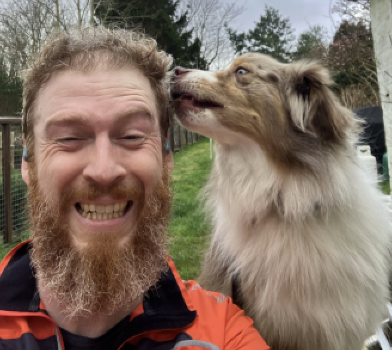
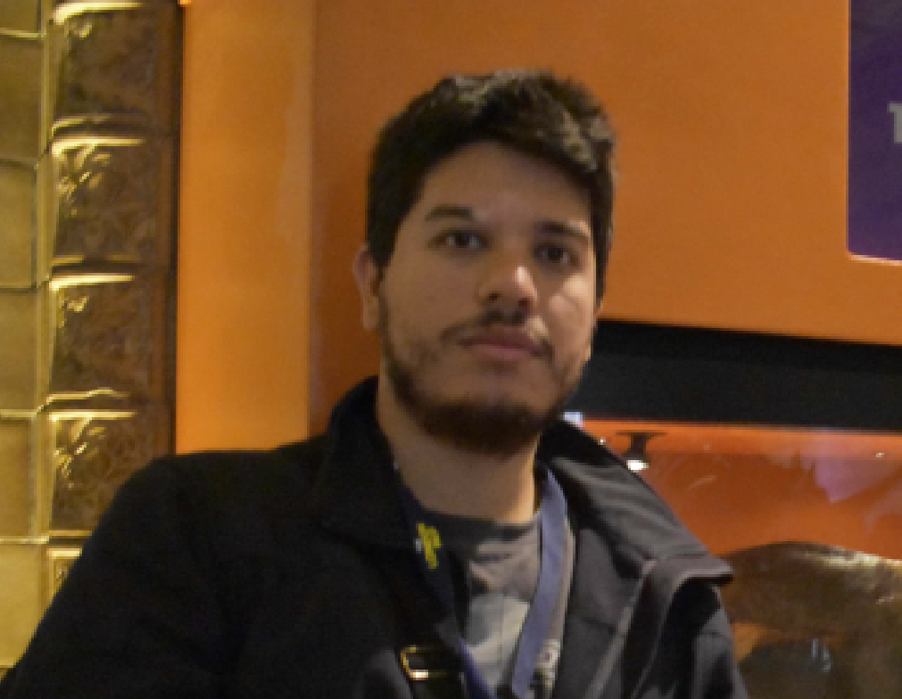

 
 

The following tutorials will take place prior to the EnviBayes-INLA Workshop. Please refer to the [main](index.qmd#sec-costs) workshop page for tutorial fees. The fee includes one coffee break per tutorial; lunch is not included.

::: {.tutorial-card}
::: {.tutorial-copy}

::: {.tutorial-label}
TUTORIAL 1
:::

### Getting more Complex with Environmental Modelling: from `mgcv` to `Stan`

::: {.tutorial-divider}
:::

::: {.tutorial-tutor}
Dave Miller
:::

::: {.tutorial-affiliation}
Biomathematics and Statistics Scotland (BioSS) & UK Centre for Ecology and Hydrology (UKCEH)
:::

:::

::: {.tutorial-photo}
{fig-alt="Portrait of Dave Miller"}
:::
This tutorial will provide a brief introduction to making the jump from modelling in the GAM-centric package `mgcv` to the more general `Stan` probabilistic programming language. It will give some background on how the innards of `mgcv` work and how we can adapt these constructions to be used in more general ecological and environmental models. Adding spatial and temporal smoothers and structured random effects can help to add generality and flexibility to our models. Using `mgcv` to generate these structures makes things easier, especially when it comes to highly complex effects.

**Duration:** 3 hours \
**Date: Monday 21$^\text{st}$ June** \
**Time:** 09:00 -- 12:30 \
**Venue:** Room 116, School of Mathematics & Statistics \

:::

::: {.tutorial-card}
::: {.tutorial-copy}

::: {.tutorial-label}
TUTORIAL 2
:::

### INLA AND BEYOND: Bayesian Hierarchical Modelling with `inlabru`

::: {.tutorial-divider}
:::

::: {.tutorial-tutor}
Jafet Belmont Osuna
:::

::: {.tutorial-affiliation}
University of Glasgow
:::

:::

::: {.tutorial-photo}
{fig-alt="Portrait of Jafet Belmont Osuna"}
:::
INLA, a powerful tool for efficiently fitting complex spatial models, comes with a steep learning curve. This workshop introduces `inlabru` – a user-friendly interface to INLA. Learn to specify models intuitively, handle spatial data efficiently, and focus on data structures and interpretation, rather than computational complexity!

**Duration:** 3 hours \
**Date: Monday 21$^\text{st}$ June** \
**Time:** 13:30 -- 17:00 \
**Venue:** Room 116, School of Mathematics & Statistics \
:::

<!-- ::: {.callout-note appearance="minimal" icon="false"} -->
<!-- ## Getting more Complex with Environmental Modelling: from `mgcv` to `Stan` -->
<!-- \ -->
<!-- **Dave Miller,** Biomathematics and Statistics Scotland (BioSS) & UK Centre for Ecology and Hydrology (UKCEH) -->
<!-- \ -->

<!-- This tutorial will provide a brief introduction to making the jump from modelling in the GAM-centric package `mgcv` to the more general `Stan` probabilistic programming language. It will give some background on how the innards of `mgcv` work and how we can adapt these constructions to be used in more general ecological and environmental models. Adding spatial and temporal smoothers and structured random effects can help to add generality and flexibility to our models. Using `mgcv` to generate these structures makes things easier, especially when it comes to highly complex effects. -->

<!-- **Duration:** 3 hours \ -->
<!-- **Date: Monday 21$^\text{st}$ June, 2027** \ -->
<!-- **Time:** 09:00 -- 12:30 \ -->
<!-- **Venue:** Room 116, School of Mathematics & Statistics \ -->

<!-- ::: -->

<!-- ::: {.callout-note appearance="minimal" icon="false"} -->
<!-- ## INLA AND BEYOND: Bayesian Hierarchical Modelling with `inlabru` -->
<!-- \ -->
<!-- **Jafet Belmont Osuna,** University of Glasgow -->
<!-- \ -->

<!-- INLA, a powerful tool for efficiently fitting complex spatial models, comes with a steep learning curve. This workshop introduces `inlabru` – a user-friendly interface to INLA. Learn to specify models intuitively, handle spatial data efficiently, and focus on data structures and interpretation, rather than computational complexity! -->

<!-- **Duration:** 3 hours \ -->
<!-- **Date: Monday 21$^\text{st}$ June, 2027** \ -->
<!-- **Time:** 13:30 -- 17:00 \ -->
<!-- **Venue:** Room 116, School of Mathematics & Statistics \ -->
<!-- ::: -->

<!-- ::: coming-soon -->
<!-- Additional information for tutorials will be added here soon. -->
<!-- ::: -->
  
  